# Panduan Visual Menjalankan Flow 1–6 SPSE

Dokumen ini dibuat dari satu eksekusi headed berurutan pada staging SPSE 2. Setiap screenshot menampilkan titik tindakan yang ditandai oleh capture guide. Arahkan perhatian ke marker/lingkaran oranye pada gambar, kemudian ikuti instruksi **Klik**, **Isi**, **Pilih**, **Unggah**, atau **Download**.

## Paket yang digunakan

- **Package ID:** `01M0JHDKPG5FN4VX636KT6CWJ2`
- **Nama:** [QA] [Penunjukan Langsung] [Automation] [070] - 65914625Belanja Obat-Obatan-Obat-Obatan Lainnya - Bahan Reagent (5.1.02.01.01.0038.06)BLUDPenunjukan LangsungRp 10,5 M2026Pengadaan BarangDINAS KESEHATAN - 1787328648283
- **URL:** [Buka paket di SPSE 2](https://pengadaan-stg-2.eproc.dev/spse/paketnontender/01M0JHDKPG5FN4VX636KT6CWJ2/edit?step=3)
- **Satuan kerja:** DINAS KESEHATAN
- **Jenis / metode:** Pengadaan Barang / Penunjukan Langsung
- **Pagu:** Rp10.500.000.000
- **HPS:** Rp10.000.000.000
- **Status akhir:** `FLOW6_SUBMISSION_COMPLETED`

## Prasyarat dan konfigurasi

1. Pastikan VPN/staging dapat diakses dan gunakan base URL **https://pengadaan-stg-2.eproc.dev/spse/**.
2. Salin konfigurasi akun ke `.env` sesuai role (PPK, Kepala UKPBJ, Pokja 1–3, dan Penyedia). Jangan menaruh password di dokumentasi atau commit.
3. Jalankan dari root repository: `npm install`, lalu gunakan `ENV=SIT`.
4. Untuk jadwal pelatihan, pilih **Sesi #25** pada panel sesi di bagian bawah halaman. Flow 5 memakai `23-08-2026 10:00`; Flow 6 memakai `24-08-2026 10:00`. Tanggal undangan memakai tanggal real dan tidak divalidasi terhadap sesi.
5. Fixture utama: `packages/web-automation/spse/fixtures/data/flow5.data.js`, `packages/web-automation/spse/fixtures/data/flow6.data.js`, dan `packages/web-automation/spse/fixtures/data/pokja-approval.data.js`. Pilih subset data di fixture sebelum menjalankan ulang.

## Jalankan berurutan

Perintah berikut dipakai satu per satu. Flow berikutnya membaca manifest dari Flow 1, jadi jangan mengganti atau menghapus file manifest di tengah rangkaian.

```bash
SPSE_PACKAGE_MANIFEST="$PWD/packages/web-automation/docs/visual-guide-flow1-6-20260821/package-manifest.json" \
SPSE_GUIDE_CAPTURE=true \
SPSE_GUIDE_DIR="$PWD/packages/web-automation/docs/visual-guide-flow1-6-20260821" \
ENV=SIT \
npm run test:spse:headed -- spse/tests/e2e/create-health-construction-non-tender.spec.js --project=spse --workers=1

SPSE_PACKAGE_MANIFEST="$PWD/packages/web-automation/docs/visual-guide-flow1-6-20260821/package-manifest.json" \
SPSE_GUIDE_CAPTURE=true \
SPSE_GUIDE_DIR="$PWD/packages/web-automation/docs/visual-guide-flow1-6-20260821" \
ENV=SIT \
npm run test:spse:headed -- spse/tests/e2e/approve-health-construction-ukpbj.spec.js --project=spse --workers=1

SPSE_PACKAGE_MANIFEST="$PWD/packages/web-automation/docs/visual-guide-flow1-6-20260821/package-manifest.json" \
SPSE_GUIDE_CAPTURE=true \
SPSE_GUIDE_DIR="$PWD/packages/web-automation/docs/visual-guide-flow1-6-20260821" \
ENV=SIT \
SPSE_POKJA_NAME="Cirebon Pokja Trial" npm run test:spse:headed -- spse/tests/e2e/approve-non-tender-pokja.spec.js --project=spse --workers=1

SPSE_PACKAGE_MANIFEST="$PWD/packages/web-automation/docs/visual-guide-flow1-6-20260821/package-manifest.json" \
SPSE_GUIDE_CAPTURE=true \
SPSE_GUIDE_DIR="$PWD/packages/web-automation/docs/visual-guide-flow1-6-20260821" \
ENV=SIT \
SPSE_PROVIDER_USERNAME="$SPSE_PROVIDER_USERNAME" SPSE_PROVIDER_PASSWORD="$SPSE_PROVIDER_PASSWORD" npm run test:spse:headed -- spse/tests/e2e/accept-non-tender-provider.spec.js --project=spse --workers=1

SPSE_PACKAGE_MANIFEST="$PWD/packages/web-automation/docs/visual-guide-flow1-6-20260821/package-manifest.json" \
SPSE_GUIDE_CAPTURE=true \
SPSE_GUIDE_DIR="$PWD/packages/web-automation/docs/visual-guide-flow1-6-20260821" \
ENV=SIT \
SPSE_PROVIDER_USERNAME="$SPSE_PROVIDER_USERNAME" SPSE_PROVIDER_PASSWORD="$SPSE_PROVIDER_PASSWORD" SPSE_POKJA_NAME="Cirebon Pokja Trial" npm run test:spse:headed -- spse/tests/e2e/flow5-explanation.spec.js --project=spse --workers=1

SPSE_PACKAGE_MANIFEST="$PWD/packages/web-automation/docs/visual-guide-flow1-6-20260821/package-manifest.json" \
SPSE_GUIDE_CAPTURE=true \
SPSE_GUIDE_DIR="$PWD/packages/web-automation/docs/visual-guide-flow1-6-20260821" \
ENV=SIT \
SPSE_PROVIDER_USERNAME="$SPSE_PROVIDER_USERNAME" SPSE_PROVIDER_PASSWORD="$SPSE_PROVIDER_PASSWORD" npm run test:spse:headed -- spse/tests/e2e/flow6-qualification.spec.js --project=spse --workers=1

SPSE_PACKAGE_MANIFEST="$PWD/packages/web-automation/docs/visual-guide-flow1-6-20260821/package-manifest.json" \
SPSE_GUIDE_CAPTURE=true \
SPSE_GUIDE_DIR="$PWD/packages/web-automation/docs/visual-guide-flow1-6-20260821" \
ENV=SIT \
SPSE_PROVIDER_USERNAME="$SPSE_PROVIDER_USERNAME" SPSE_PROVIDER_PASSWORD="$SPSE_PROVIDER_PASSWORD" npm run test:spse:headed -- spse/tests/e2e/flow6-offer.spec.js --project=spse --workers=1
```

## Ringkasan validasi hasil

| Flow | Status yang diharapkan | Hasil eksekusi |
|---|---|---|
| 1 | SENT_TO_UKPBJ | berhasil |
| 2 | SENT_TO_POKJA | berhasil |
| 3 | POKJA_APPROVED | berhasil (3 anggota) |
| 4 | ACCEPTED_BY_PROVIDER | berhasil + validasi Beranda |
| 5 | FLOW5_EXPLANATION_COMPLETED | berhasil (5 pertanyaan + 5 jawaban) |
| 6 | FLOW6_SUBMISSION_COMPLETED | berhasil |

## Flow 1 — PPK membuat paket Non-Tender

**Peran:** PPK / Dinas Kesehatan  
**Tujuan:** Membuat paket Pengadaan Barang dengan metode Penunjukan Langsung dan meneruskannya ke Kepala UKPBJ.

### Arahan singkat

- **Klik:** Klik LOGIN untuk masuk sebagai PPK. Halaman autentikasi INAPROC terbuka.
- **Isi:** Isi Alamat email akun PPK. Email siap diproses.
- **Klik:** Klik Lanjut setelah email PPK. Form Sandi ditampilkan.
- **Isi:** Isi Sandi PPK. Sandi tersimpan secara tersensor.
- **Pilih:** Pilih role PPK untuk satker yang sesuai. Dashboard PPK terbuka.
- **Klik:** Buka menu navigasi DAFTAR PAKET. Menu dropdown paket tampil.
- **Klik:** Klik tab Non Tender. Daftar paket Non Tender ditampilkan.
- **Klik:** Klik Buat Paket. Form pemilihan RUP terbuka.
- **Pilih:** Pilih Satuan Kerja DINAS KESEHATAN. RUP difilter untuk satuan kerja tersebut.
- **Pilih:** Pilih Metode Pemilihan Penunjukan Langsung. Tabel hanya menampilkan RUP dengan metode yang sesuai.
- **Pilih:** Pilih Jenis Pengadaan Pengadaan Barang. Jenis pengadaan paket terpilih.
- **Pilih:** Pilih checkbox RUP: 65914625Belanja Obat-Obatan-Obat-Obatan Lainnya - .... RUP terpilih untuk dibuat menjadi paket.
- **Isi:** Isi Nama Paket Non Tender. Nama paket tampil pada draft.
- **Klik:** Klik Selanjutnya menuju Dokumen Persiapan. Step 2 draft paket terbuka.
- **Klik:** Klik KBKI pada item 1. Modal pemilihan KBKI terbuka.
- **Klik:** Klik Cari KBKI. Daftar kode KBKI ditampilkan.
- **Pilih:** Pilih kode KBKI untuk item 1. Kode KBKI ditandai.
- **Klik:** Klik Simpan pada Rincian HPS. Rincian HPS dan KBKI tersimpan.
- **Klik:** Klik Kirim Email kepada Kepala UKPBJ. Status email berubah menjadi Sudah dikirim.
- **Klik:** Klik Simpan untuk membuat paket dan meneruskan ke Kepala UKPBJ. Data paket tersimpan dan manifest Flow 1 dibuat.

### Screenshot langkah

#### Langkah 1 — Klik LOGIN untuk masuk sebagai PPK

**Klik:** Halaman autentikasi INAPROC terbuka.

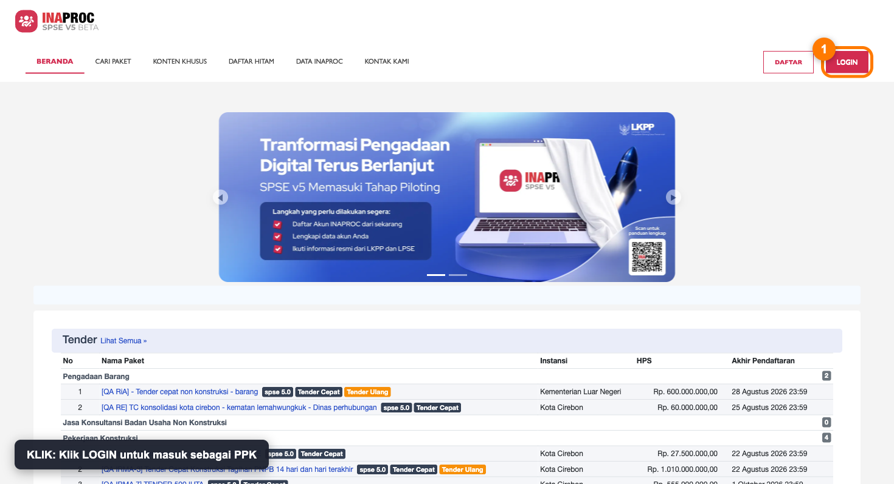

#### Langkah 2 — Isi Alamat email akun PPK

**Isi:** Email siap diproses.

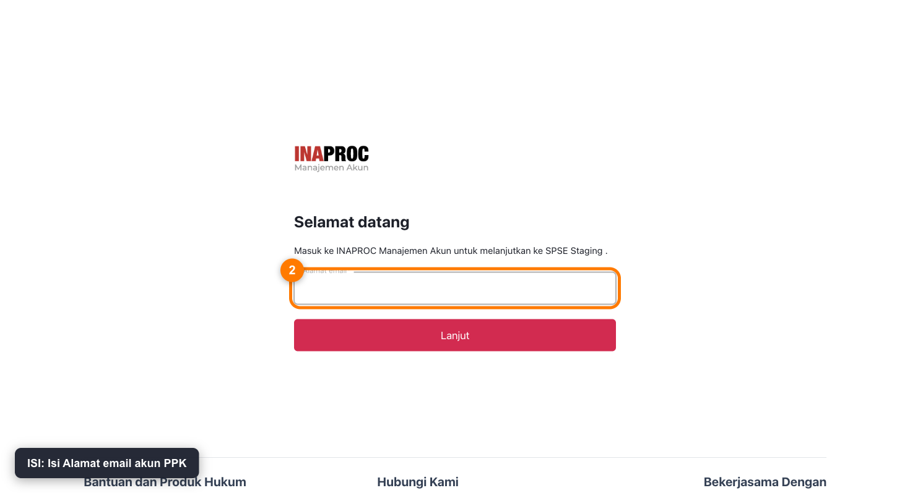

#### Langkah 3 — Klik Lanjut setelah email PPK

**Klik:** Form Sandi ditampilkan.


#### Langkah 4 — Isi Sandi PPK

**Isi:** Sandi tersimpan secara tersensor.

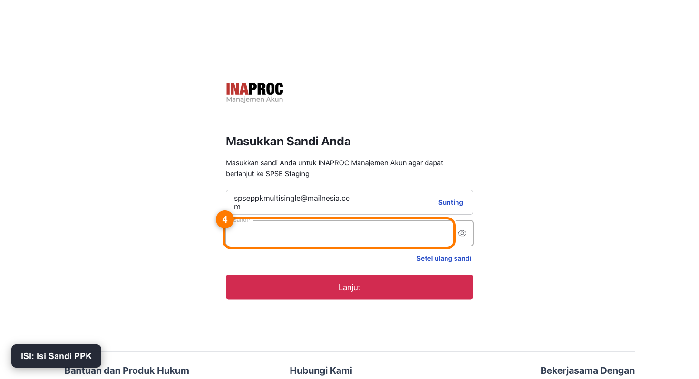

#### Langkah 5 — Pilih role PPK untuk satker yang sesuai

**Pilih:** Dashboard PPK terbuka.

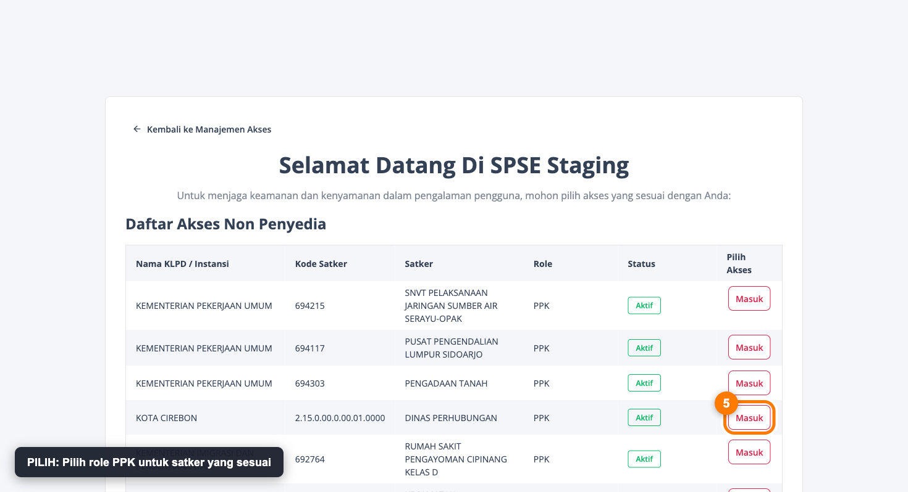

#### Langkah 6 — Buka menu navigasi DAFTAR PAKET

**Klik:** Menu dropdown paket tampil.

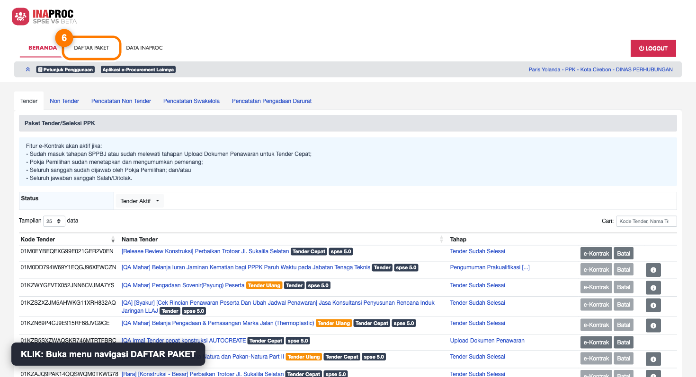

#### Langkah 7 — Klik tab Non Tender

**Klik:** Daftar paket Non Tender ditampilkan.

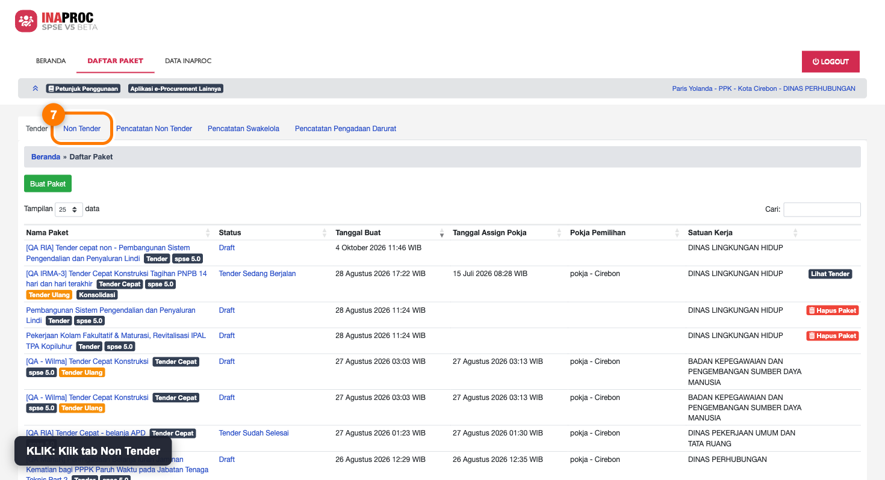

#### Langkah 8 — Klik Buat Paket

**Klik:** Form pemilihan RUP terbuka.

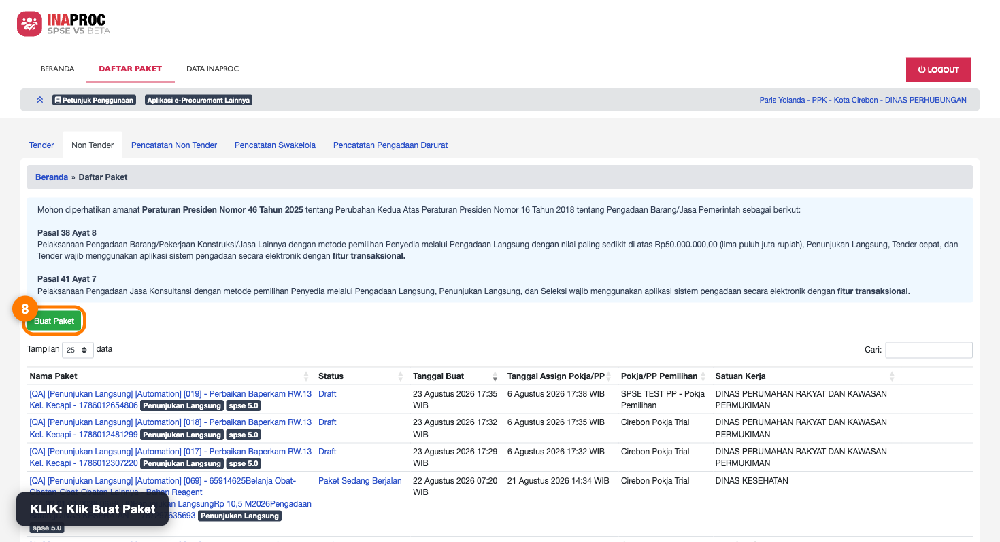

#### Langkah 9 — Pilih Satuan Kerja DINAS KESEHATAN

**Pilih:** RUP difilter untuk satuan kerja tersebut.

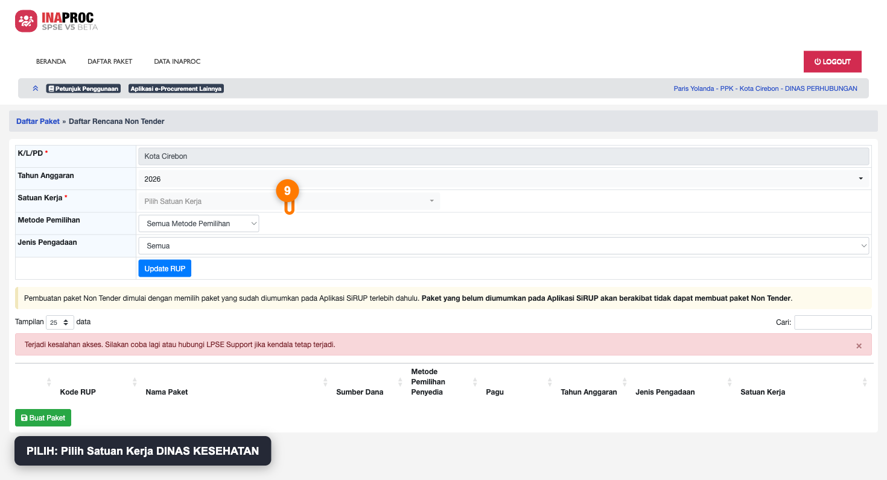

#### Langkah 10 — Pilih Metode Pemilihan Penunjukan Langsung

**Pilih:** Tabel hanya menampilkan RUP dengan metode yang sesuai.

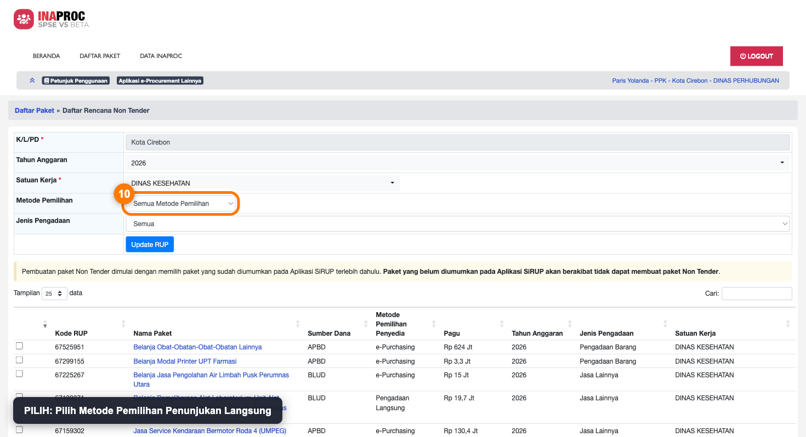

#### Langkah 11 — Pilih Jenis Pengadaan Pengadaan Barang

**Pilih:** Jenis pengadaan paket terpilih.

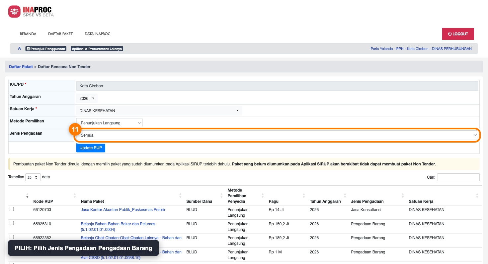

#### Langkah 12 — Pilih checkbox RUP: 65914625Belanja Obat-Obatan-Obat-Obatan Lainnya - ...

**Pilih:** RUP terpilih untuk dibuat menjadi paket.

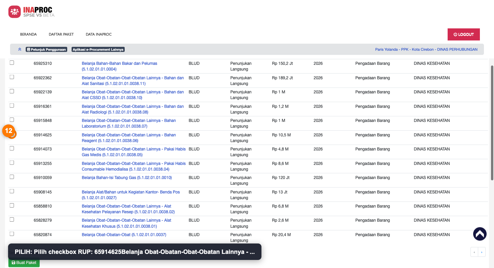

#### Langkah 13 — Isi Nama Paket Non Tender

**Isi:** Nama paket tampil pada draft.

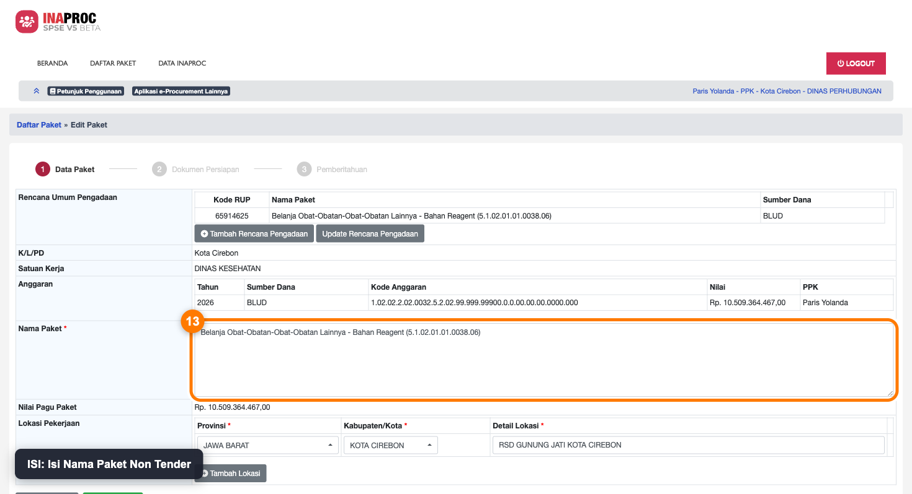

#### Langkah 14 — Klik Selanjutnya menuju Dokumen Persiapan

**Klik:** Step 2 draft paket terbuka.

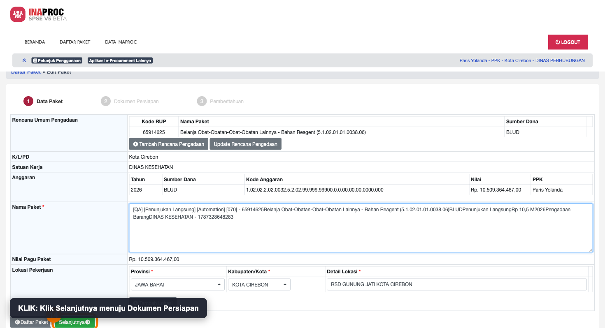

#### Langkah 15 — Klik KBKI pada item 1

**Klik:** Modal pemilihan KBKI terbuka.

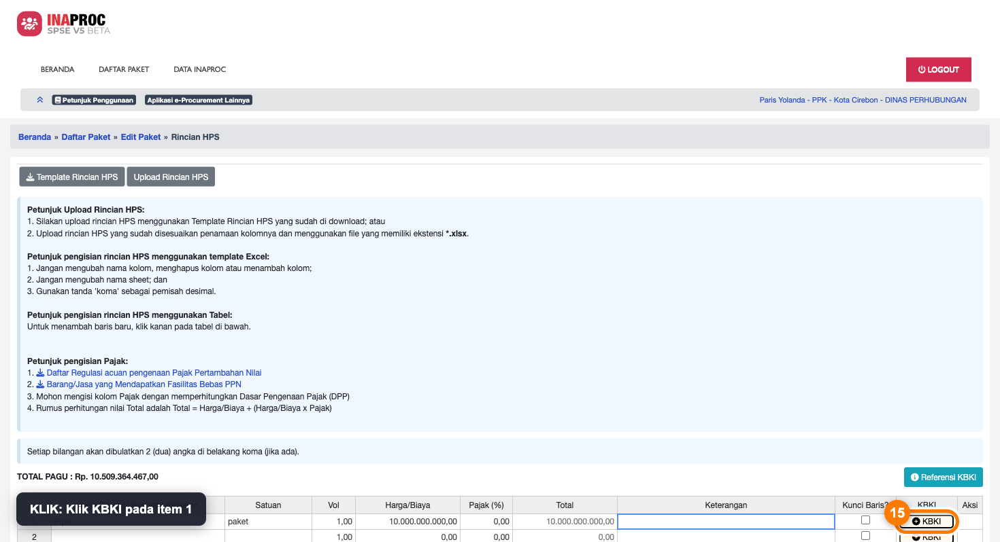

#### Langkah 16 — Klik Cari KBKI

**Klik:** Daftar kode KBKI ditampilkan.

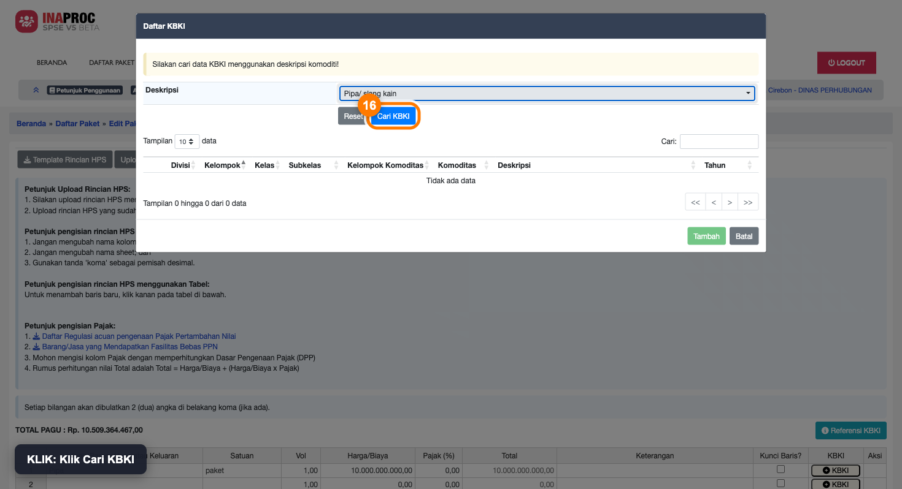

#### Langkah 17 — Pilih kode KBKI untuk item 1

**Pilih:** Kode KBKI ditandai.

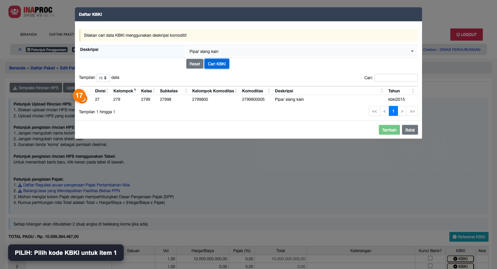

#### Langkah 18 — Klik Simpan pada Rincian HPS

**Klik:** Rincian HPS dan KBKI tersimpan.

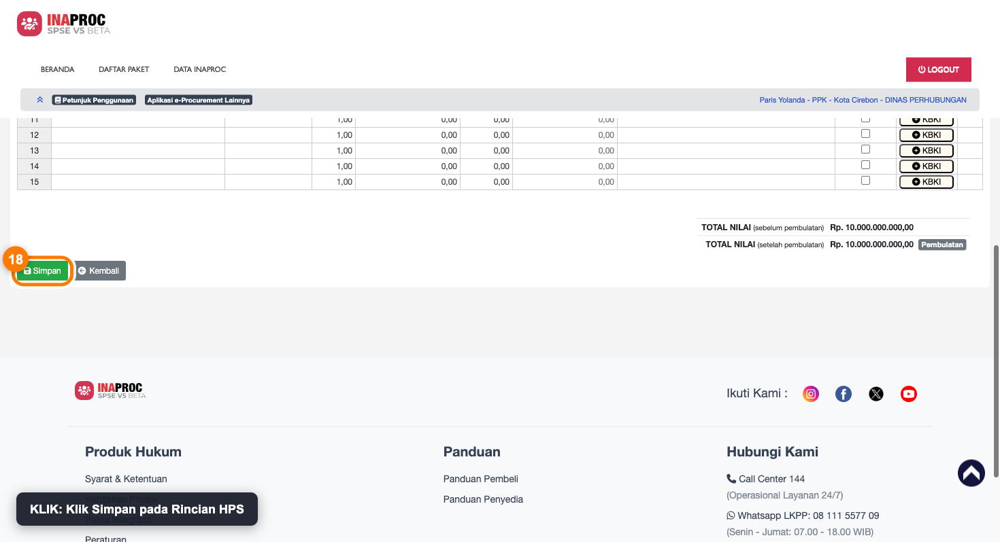

#### Langkah 19 — Klik Kirim Email kepada Kepala UKPBJ

**Klik:** Status email berubah menjadi Sudah dikirim.

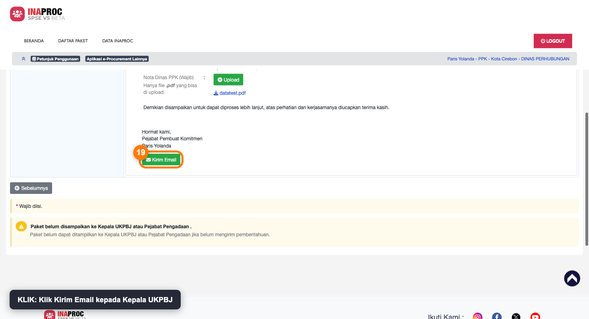

#### Langkah 20 — Klik Simpan untuk membuat paket dan meneruskan ke Kepala UKPBJ

**Klik:** Data paket tersimpan dan manifest Flow 1 dibuat.

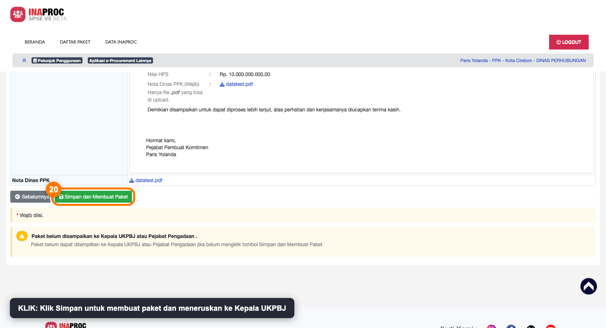

## Flow 2 — Kepala UKPBJ meneruskan paket ke Pokja

**Peran:** Kepala UKPBJ  
**Tujuan:** Memverifikasi paket yang dibuat PPK dan mengirimkannya kepada Pokja.

### Arahan singkat

- **Klik:** Klik LOGIN untuk masuk sebagai Kepala UKPBJ. Halaman autentikasi INAPROC terbuka.
- **Isi:** Isi Alamat email akun Kepala UKPBJ. Email siap diproses.
- **Klik:** Klik Lanjut setelah email Kepala UKPBJ. Form Sandi ditampilkan.
- **Isi:** Isi Sandi Kepala UKPBJ. Sandi tersimpan secara tersensor.
- **Klik:** Klik Lanjutkan tanpa Security Key. Halaman pemilihan role ditampilkan.
- **Pilih:** Pilih role Kepala UKPBJ. Dashboard Kepala UKPBJ terbuka.
- **Klik:** Klik menu Non Tender pada akun Kepala UKPBJ. Daftar paket yang perlu diverifikasi ditampilkan.
- **Klik:** Klik paket exact [QA] [Penunjukan Langsung] [Automation] [070] - 65914625Belanja Obat-Obatan-Obat-Obatan Lainnya - Bahan Reagent (5.1.02.01.01.0038.06)BLUDPenunjukan LangsungRp 10,5 M2026Pengadaan BarangDINAS KESEHATAN - 1787328648283. Detail paket Flow 1 terbuka.

### Screenshot langkah

#### Langkah 1 — Klik LOGIN untuk masuk sebagai Kepala UKPBJ

**Klik:** Halaman autentikasi INAPROC terbuka.


#### Langkah 2 — Isi Alamat email akun Kepala UKPBJ

**Isi:** Email siap diproses.

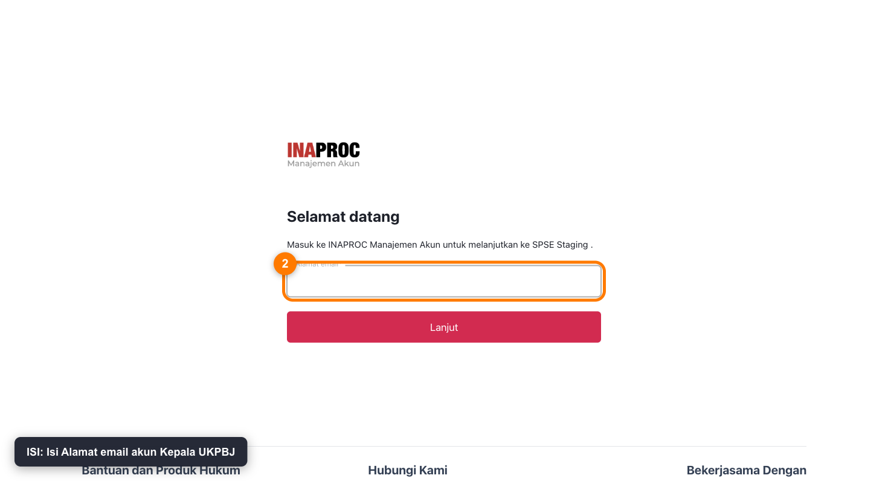

#### Langkah 3 — Klik Lanjut setelah email Kepala UKPBJ

**Klik:** Form Sandi ditampilkan.

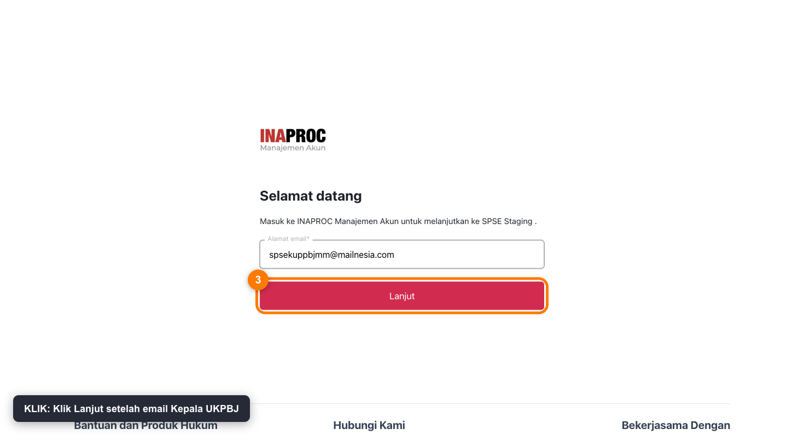

#### Langkah 4 — Isi Sandi Kepala UKPBJ

**Isi:** Sandi tersimpan secara tersensor.


#### Langkah 5 — Klik Lanjutkan tanpa Security Key

**Klik:** Halaman pemilihan role ditampilkan.


#### Langkah 6 — Klik Lanjutkan tanpa Security Key

**Klik:** Halaman pemilihan role ditampilkan.


#### Langkah 7 — Pilih role Kepala UKPBJ

**Pilih:** Dashboard Kepala UKPBJ terbuka.

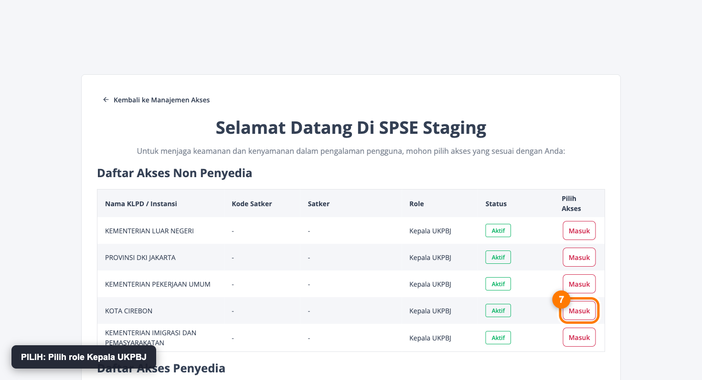

#### Langkah 8 — Klik menu Non Tender pada akun Kepala UKPBJ

**Klik:** Daftar paket yang perlu diverifikasi ditampilkan.

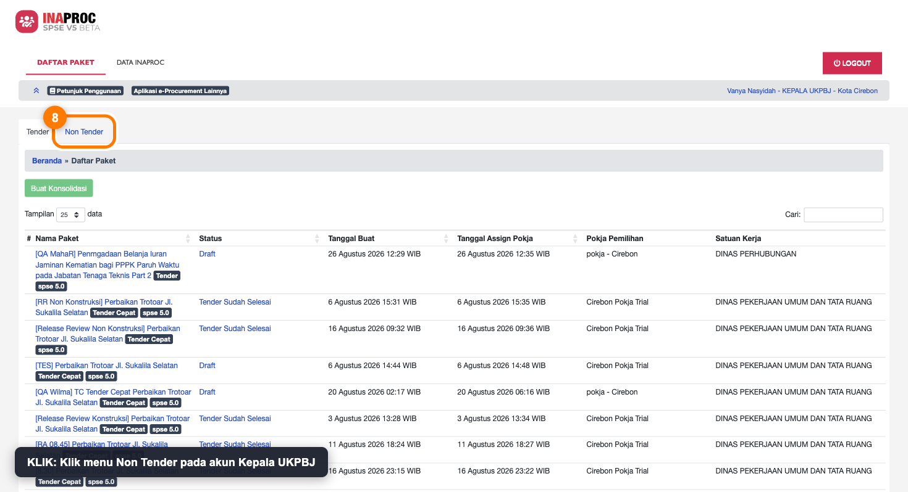

#### Langkah 9 — Klik paket exact [QA] [Penunjukan Langsung] [Automation] [070] - 65914625Belanja Obat-Obatan-Obat-Obatan Lainnya - Bahan Reagent (5.1.02.01.01.0038.06)BLUDPenunjukan LangsungRp 10,5 M2026Pengadaan BarangDINAS KESEHATAN - 1787328648283

**Klik:** Detail paket Flow 1 terbuka.

![Flow 2 langkah 9: Klik paket exact [QA] [Penunjukan Langsung] [Automation] [070] - 65914625Belanja Obat-Obatan-Obat-Obatan Lainnya - Bahan Reagent (5.1.02.01.01.0038.06)BLUDPenunjukan LangsungRp 10,5 M2026Pengadaan BarangDINAS KESEHATAN - 1787328648283](./flow2/09-klik-paket-exact-qa-penunjukan-langsung-automation-070-65914.png)

## Flow 3 — Tiga anggota Pokja menyetujui paket

**Peran:** Pokja 1, Pokja 2, Pokja 3  
**Tujuan:** Mengisi jadwal, kualifikasi/KBKI bila diperlukan, dokumen persiapan, penyedia, lalu menyetujui Pakta Integritas secara berurutan.

### Arahan singkat

- **Klik:** Klik LOGIN untuk masuk sebagai anggota Pokja. Halaman autentikasi ditampilkan.
- **Isi:** Isi Alamat email anggota Pokja. Email siap diproses.
- **Isi:** Isi Sandi anggota Pokja. Sandi tersimpan secara tersensor.
- **Klik:** Klik Lanjutkan tanpa Security Key. Proses login Pokja berlanjut.
- **Pilih:** Pilih role Anggota Pokja Pemilihan Kota Cirebon. Dashboard Pokja terbuka.
- **Klik:** Klik DAFTAR PAKET pada dashboard Pokja. Daftar paket Pokja ditampilkan.
- **Klik:** Klik tab Non Tender. Paket Penunjukan Langsung ditampilkan.
- **Klik:** Klik Buat Non Tender pada paket yang ditugaskan. Halaman konfigurasi paket terbuka.
- **Klik:** Klik Jadwal Paket. Form sembilan tahap jadwal terbuka.
- **Klik:** Klik Simpan setelah jadwal H+1 sampai H+9 diisi. Semua Jadwal berhasil tersimpan.
- **Klik:** Klik Persyaratan Kualifikasi. Form klasifikasi dan persyaratan terbuka.
- **Klik:** Klik Masa Berlaku Penawaran. Field masa berlaku ditampilkan.
- **Isi:** Isi masa berlaku penawaran 90 hari. Masa berlaku tersimpan.
- **Klik:** Klik Dokumen Penawaran. Daftar persyaratan dokumen ditampilkan.
- **Unggah:** Klik Upload pada Dokumen Pemilihan (SDP). Form upload SDP terbuka.
- **Klik:** Klik Kirim untuk membuat undangan reviu DPP. Form undangan ditampilkan.
- **Klik:** Klik Kirim Pesan untuk mengirim undangan. Undangan reviu DPP berhasil terkirim.
- **Unggah:** Klik Upload untuk mengunggah BA hasil reviu. Form upload BA reviu terbuka.
- **Klik:** Klik Pilih Penyedia. Halaman pencarian penyedia terbuka.
- **Pilih:** Centang penyedia ANGSAE. Penyedia target ditandai.
- **Klik:** Klik Setuju pada Pakta Integritas. Persetujuan anggota Pokja tercatat.

### Screenshot langkah

#### Langkah 1 — Klik LOGIN untuk masuk sebagai anggota Pokja

**Klik:** Halaman autentikasi ditampilkan.


#### Langkah 2 — Isi Alamat email anggota Pokja

**Isi:** Email siap diproses.


#### Langkah 3 — Isi Sandi anggota Pokja

**Isi:** Sandi tersimpan secara tersensor.


#### Langkah 4 — Klik Lanjutkan tanpa Security Key

**Klik:** Proses login Pokja berlanjut.


#### Langkah 5 — Pilih role Anggota Pokja Pemilihan Kota Cirebon

**Pilih:** Dashboard Pokja terbuka.


#### Langkah 6 — Klik DAFTAR PAKET pada dashboard Pokja

**Klik:** Daftar paket Pokja ditampilkan.


#### Langkah 7 — Klik tab Non Tender

**Klik:** Paket Penunjukan Langsung ditampilkan.


#### Langkah 8 — Klik Buat Non Tender pada paket yang ditugaskan

**Klik:** Halaman konfigurasi paket terbuka.

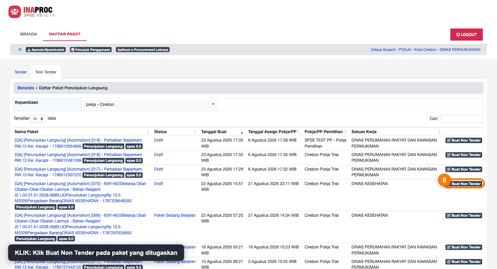

#### Langkah 9 — Klik Jadwal Paket

**Klik:** Form sembilan tahap jadwal terbuka.


#### Langkah 10 — Klik Simpan setelah jadwal H+1 sampai H+9 diisi

**Klik:** Semua Jadwal berhasil tersimpan.


#### Langkah 11 — Klik Persyaratan Kualifikasi

**Klik:** Form klasifikasi dan persyaratan terbuka.


#### Langkah 1 — Klik LOGIN untuk masuk sebagai anggota Pokja

**Klik:** Halaman autentikasi ditampilkan.


#### Langkah 2 — Isi Alamat email anggota Pokja

**Isi:** Email siap diproses.


#### Langkah 3 — Isi Sandi anggota Pokja

**Isi:** Sandi tersimpan secara tersensor.


#### Langkah 4 — Klik Lanjutkan tanpa Security Key

**Klik:** Proses login Pokja berlanjut.


#### Langkah 5 — Pilih role Anggota Pokja Pemilihan Kota Cirebon

**Pilih:** Dashboard Pokja terbuka.


#### Langkah 6 — Klik DAFTAR PAKET pada dashboard Pokja

**Klik:** Daftar paket Pokja ditampilkan.


#### Langkah 7 — Klik tab Non Tender

**Klik:** Paket Penunjukan Langsung ditampilkan.


#### Langkah 8 — Klik Buat Non Tender pada paket yang ditugaskan

**Klik:** Halaman konfigurasi paket terbuka.


#### Langkah 9 — Klik Jadwal Paket

**Klik:** Form sembilan tahap jadwal terbuka.


#### Langkah 10 — Klik Simpan setelah jadwal H+1 sampai H+9 diisi

**Klik:** Semua Jadwal berhasil tersimpan.


#### Langkah 11 — Klik Persyaratan Kualifikasi

**Klik:** Form klasifikasi dan persyaratan terbuka.


#### Langkah 12 — Klik LOGIN untuk masuk sebagai anggota Pokja

**Klik:** Halaman autentikasi ditampilkan.


#### Langkah 13 — Isi Alamat email anggota Pokja

**Isi:** Email siap diproses.

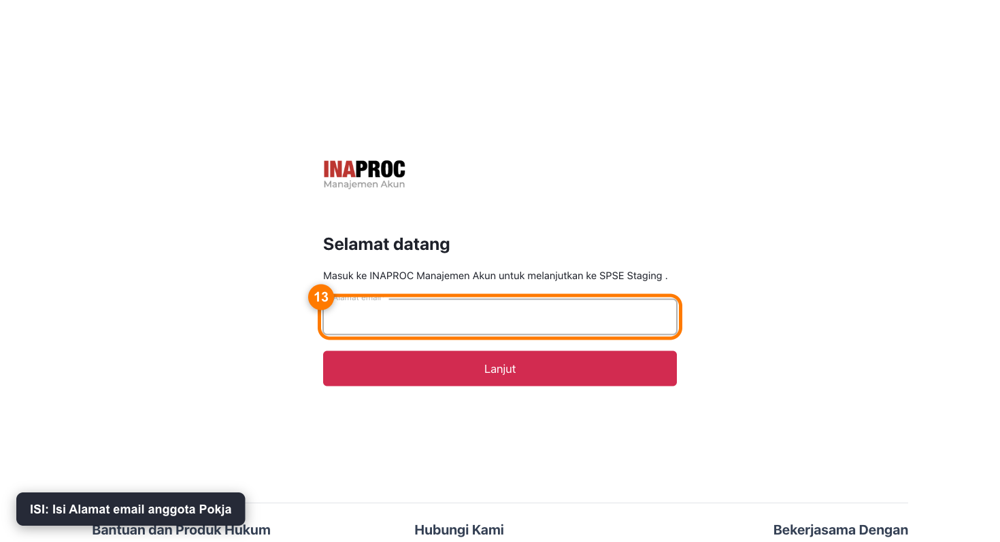

#### Langkah 14 — Isi Sandi anggota Pokja

**Isi:** Sandi tersimpan secara tersensor.


#### Langkah 15 — Klik Lanjutkan tanpa Security Key

**Klik:** Proses login Pokja berlanjut.


#### Langkah 16 — Pilih role Anggota Pokja Pemilihan Kota Cirebon

**Pilih:** Dashboard Pokja terbuka.


#### Langkah 17 — Klik DAFTAR PAKET pada dashboard Pokja

**Klik:** Daftar paket Pokja ditampilkan.

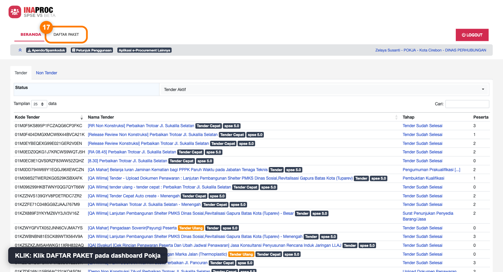

#### Langkah 18 — Klik tab Non Tender

**Klik:** Paket Penunjukan Langsung ditampilkan.


#### Langkah 19 — Klik Buat Non Tender pada paket yang ditugaskan

**Klik:** Halaman konfigurasi paket terbuka.


#### Langkah 20 — Klik Jadwal Paket

**Klik:** Form sembilan tahap jadwal terbuka.

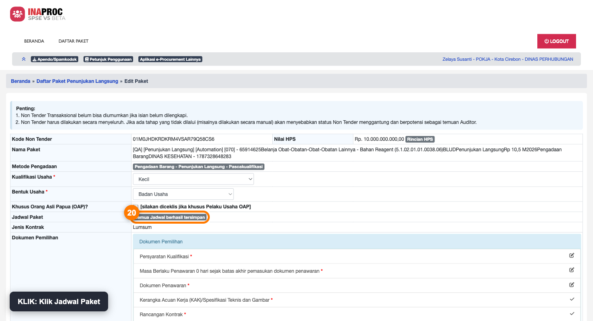

#### Langkah 21 — Klik Simpan setelah jadwal H+1 sampai H+9 diisi

**Klik:** Semua Jadwal berhasil tersimpan.

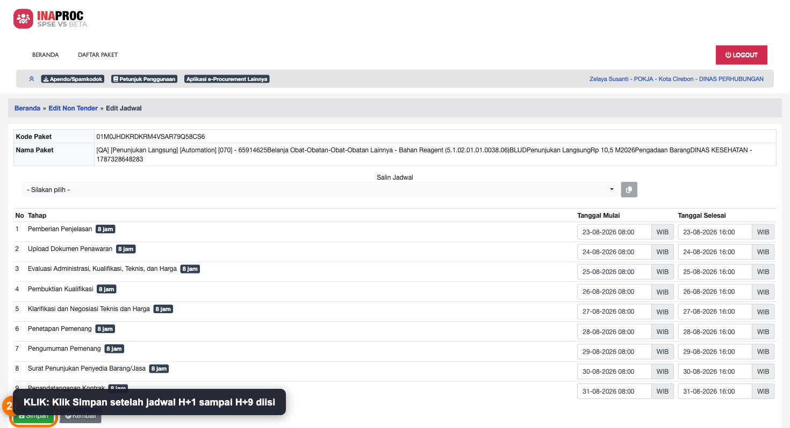

#### Langkah 22 — Klik Persyaratan Kualifikasi

**Klik:** Form klasifikasi dan persyaratan terbuka.

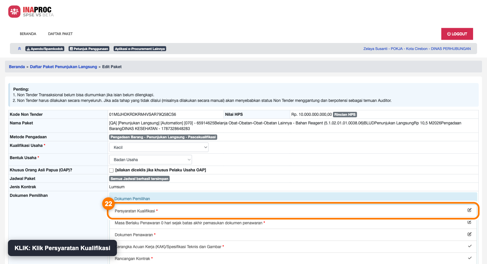

#### Langkah 23 — Klik LOGIN untuk masuk sebagai anggota Pokja

**Klik:** Halaman autentikasi ditampilkan.


#### Langkah 24 — Isi Alamat email anggota Pokja

**Isi:** Email siap diproses.


#### Langkah 25 — Isi Sandi anggota Pokja

**Isi:** Sandi tersimpan secara tersensor.


#### Langkah 26 — Klik Lanjutkan tanpa Security Key

**Klik:** Proses login Pokja berlanjut.

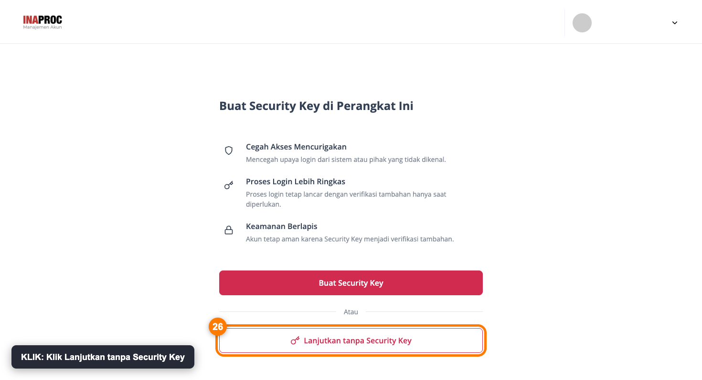

#### Langkah 27 — Pilih role Anggota Pokja Pemilihan Kota Cirebon

**Pilih:** Dashboard Pokja terbuka.

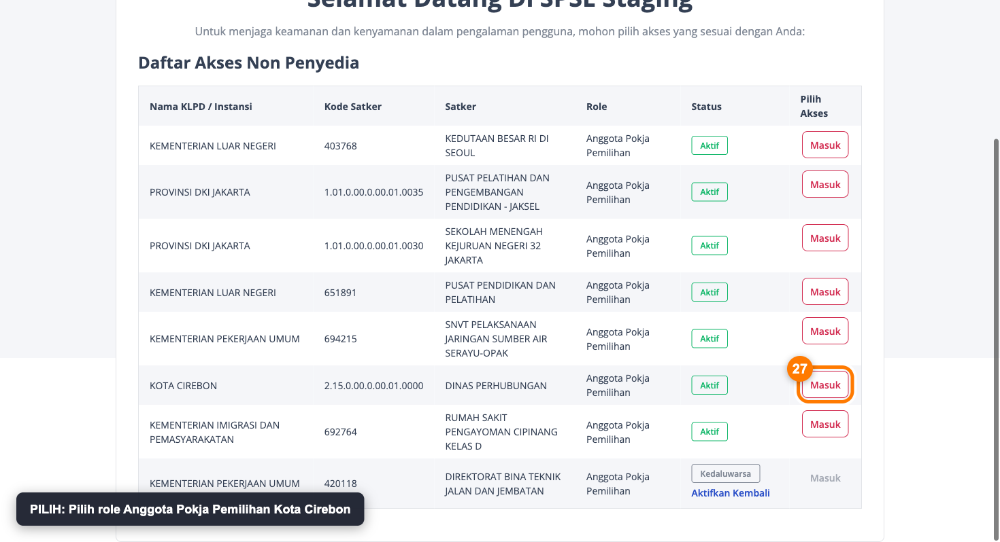

#### Langkah 28 — Klik DAFTAR PAKET pada dashboard Pokja

**Klik:** Daftar paket Pokja ditampilkan.


#### Langkah 29 — Klik tab Non Tender

**Klik:** Paket Penunjukan Langsung ditampilkan.

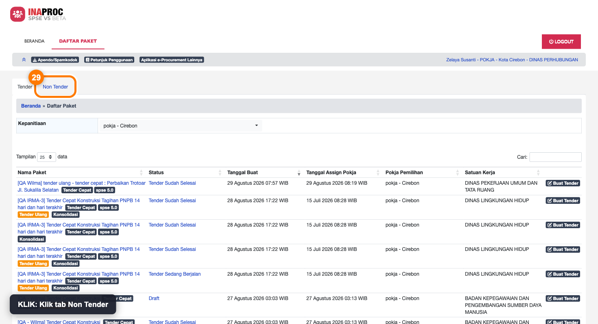

#### Langkah 30 — Klik Buat Non Tender pada paket yang ditugaskan

**Klik:** Halaman konfigurasi paket terbuka.


#### Langkah 31 — Klik Jadwal Paket

**Klik:** Form sembilan tahap jadwal terbuka.


#### Langkah 32 — Klik Simpan setelah jadwal H+1 sampai H+9 diisi

**Klik:** Semua Jadwal berhasil tersimpan.


#### Langkah 33 — Klik Persyaratan Kualifikasi

**Klik:** Form klasifikasi dan persyaratan terbuka.


#### Langkah 34 — Klik Masa Berlaku Penawaran

**Klik:** Field masa berlaku ditampilkan.

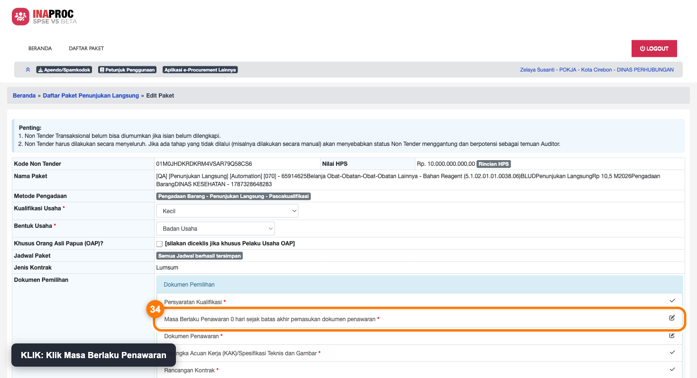

#### Langkah 35 — Isi masa berlaku penawaran 90 hari

**Isi:** Masa berlaku tersimpan.

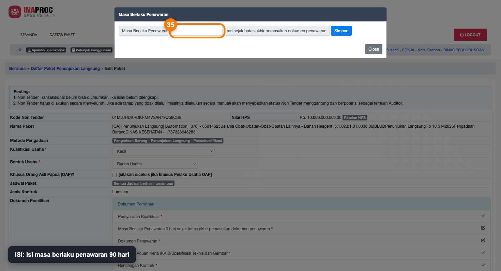

#### Langkah 36 — Klik Dokumen Penawaran

**Klik:** Daftar persyaratan dokumen ditampilkan.

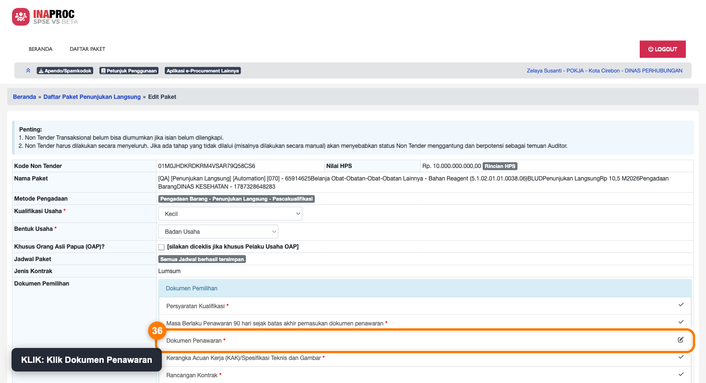

#### Langkah 37 — Klik Upload pada Dokumen Pemilihan (SDP)

**Unggah:** Form upload SDP terbuka.

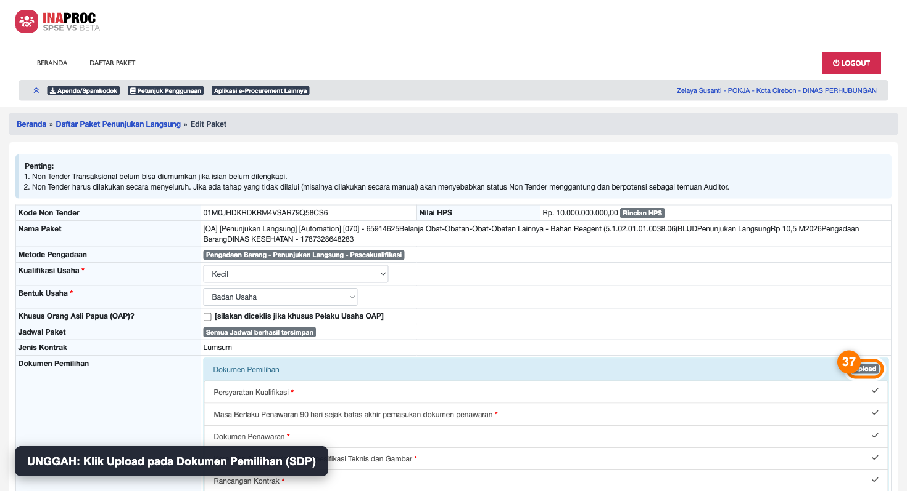

#### Langkah 38 — Klik Kirim untuk membuat undangan reviu DPP

**Klik:** Form undangan ditampilkan.

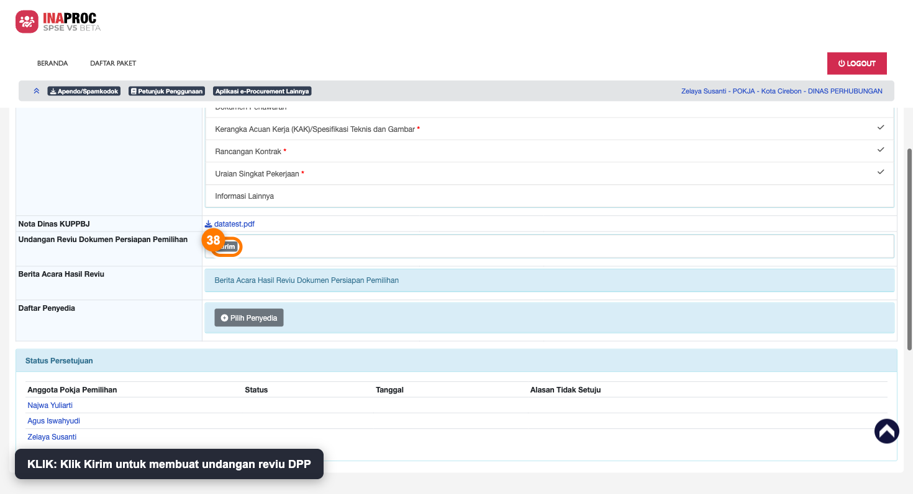

#### Langkah 39 — Klik Kirim Pesan untuk mengirim undangan

**Klik:** Undangan reviu DPP berhasil terkirim.

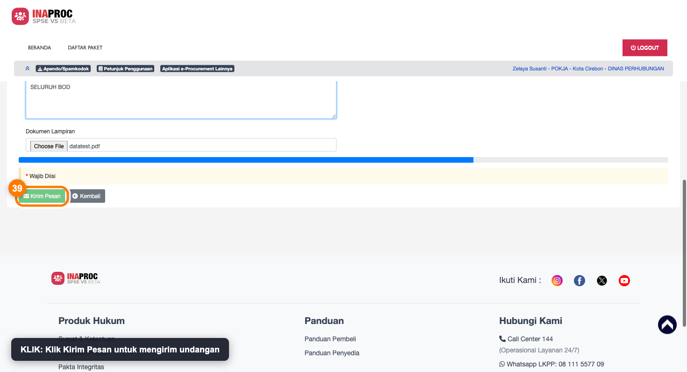

#### Langkah 40 — Klik Upload untuk mengunggah BA hasil reviu

**Unggah:** Form upload BA reviu terbuka.

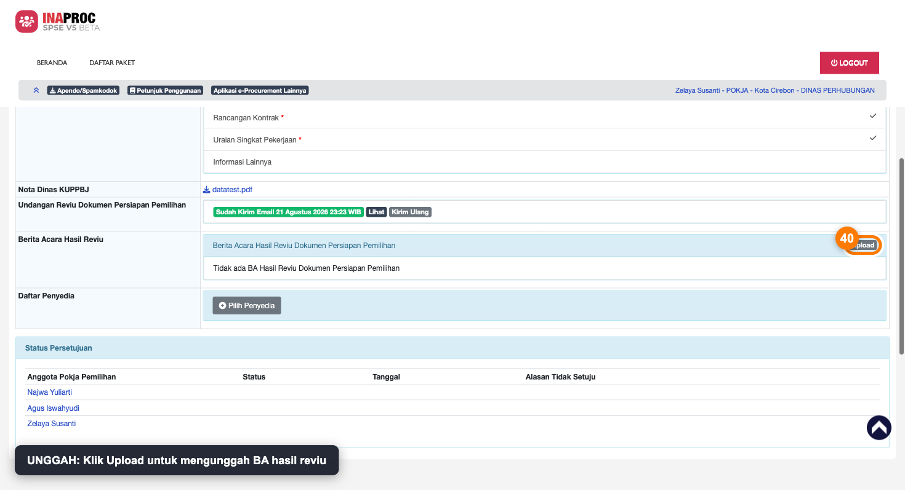

#### Langkah 41 — Klik Pilih Penyedia

**Klik:** Halaman pencarian penyedia terbuka.

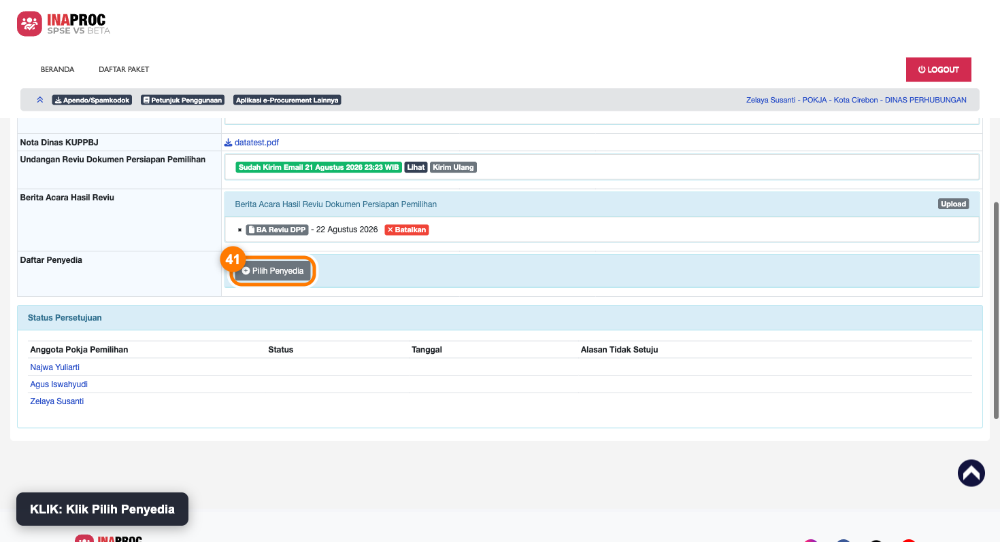

#### Langkah 42 — Centang penyedia ANGSAE

**Pilih:** Penyedia target ditandai.

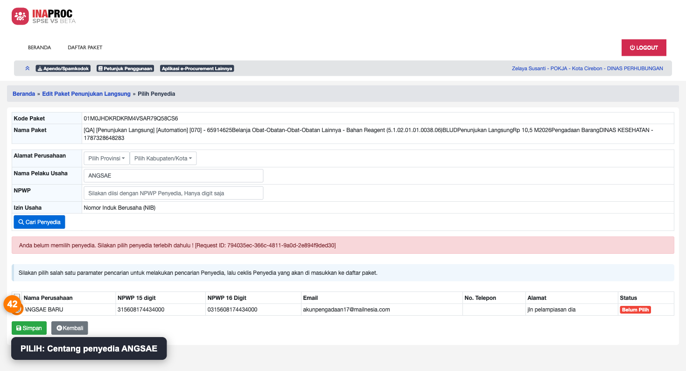

#### Langkah 43 — Klik Setuju pada Pakta Integritas

**Klik:** Persetujuan anggota Pokja tercatat.

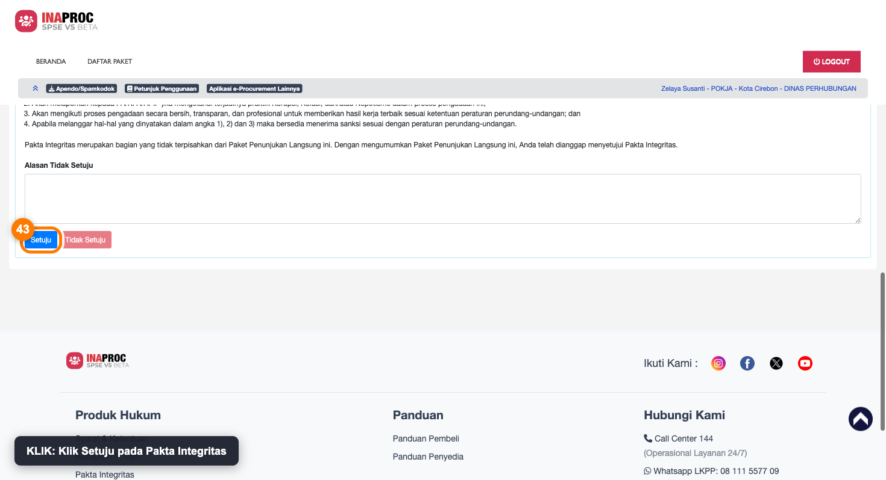

#### Langkah 44 — Klik LOGIN untuk masuk sebagai anggota Pokja

**Klik:** Halaman autentikasi ditampilkan.


#### Langkah 45 — Isi Alamat email anggota Pokja

**Isi:** Email siap diproses.


#### Langkah 46 — Isi Sandi anggota Pokja

**Isi:** Sandi tersimpan secara tersensor.


#### Langkah 47 — Klik Lanjutkan tanpa Security Key

**Klik:** Proses login Pokja berlanjut.


#### Langkah 48 — Pilih role Anggota Pokja Pemilihan Kota Cirebon

**Pilih:** Dashboard Pokja terbuka.

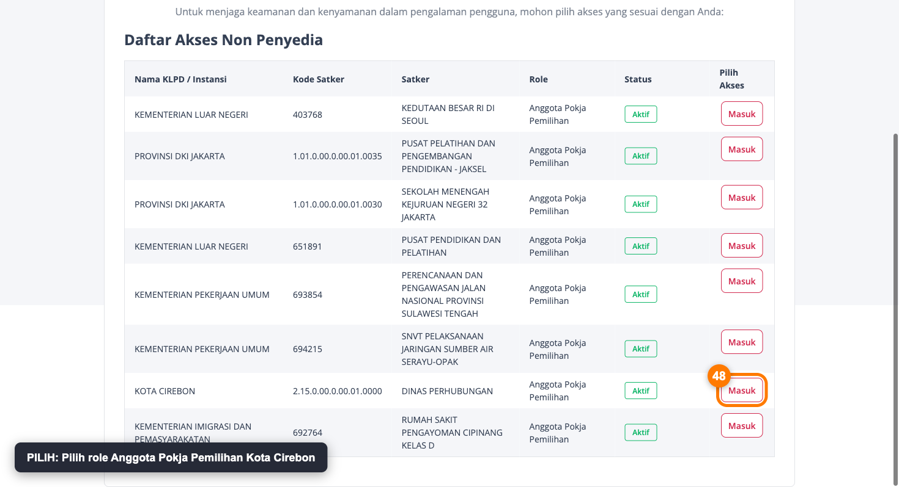

#### Langkah 49 — Klik DAFTAR PAKET pada dashboard Pokja

**Klik:** Daftar paket Pokja ditampilkan.


#### Langkah 50 — Klik tab Non Tender

**Klik:** Paket Penunjukan Langsung ditampilkan.


#### Langkah 51 — Klik Buat Non Tender pada paket yang ditugaskan

**Klik:** Halaman konfigurasi paket terbuka.

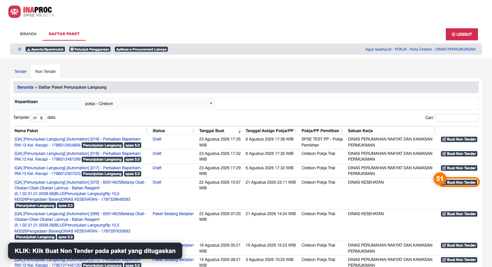

#### Langkah 52 — Klik Setuju pada Pakta Integritas

**Klik:** Persetujuan anggota Pokja tercatat.

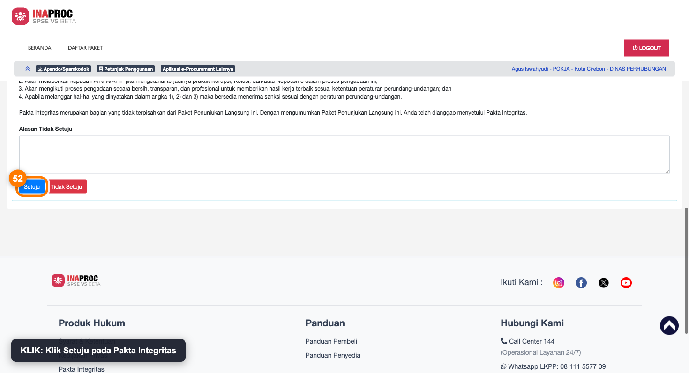

#### Langkah 53 — Klik LOGIN untuk masuk sebagai anggota Pokja

**Klik:** Halaman autentikasi ditampilkan.


#### Langkah 54 — Isi Alamat email anggota Pokja

**Isi:** Email siap diproses.


#### Langkah 55 — Isi Sandi anggota Pokja

**Isi:** Sandi tersimpan secara tersensor.


#### Langkah 56 — Klik Lanjutkan tanpa Security Key

**Klik:** Proses login Pokja berlanjut.


#### Langkah 57 — Pilih role Anggota Pokja Pemilihan Kota Cirebon

**Pilih:** Dashboard Pokja terbuka.

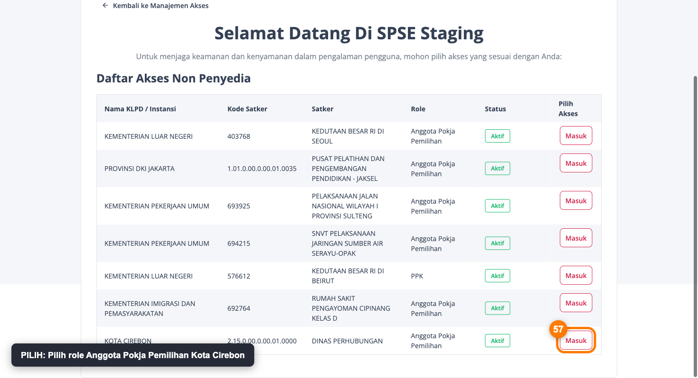

#### Langkah 58 — Klik DAFTAR PAKET pada dashboard Pokja

**Klik:** Daftar paket Pokja ditampilkan.


#### Langkah 59 — Klik tab Non Tender

**Klik:** Paket Penunjukan Langsung ditampilkan.


#### Langkah 60 — Klik Buat Non Tender pada paket yang ditugaskan

**Klik:** Halaman konfigurasi paket terbuka.


#### Langkah 61 — Klik Setuju pada Pakta Integritas

**Klik:** Persetujuan anggota Pokja tercatat.


## Flow 4 — Penyedia menyetujui dan mengikuti paket

**Peran:** Penyedia / Angsae Baru  
**Tujuan:** Membaca Pakta Integritas, klik Setuju & Ikut Paket, lalu memastikan paket masuk ke Beranda penyedia.

### Arahan singkat

- **Klik:** Klik LOGIN untuk masuk sebagai anggota Pokja. Halaman autentikasi ditampilkan.
- **Isi:** Isi Alamat email akun Penyedia. Email Penyedia siap diproses.
- **Isi:** Isi Sandi akun Penyedia. Sandi tersimpan secara tersensor.
- **Klik:** Klik Lanjutkan tanpa Security Key. Proses login Pokja berlanjut.
- **Klik:** Klik DAFTAR PAKET atau PAKET BARU. Daftar paket yang tersedia bagi Penyedia terbuka.
- **Klik:** Pilih tab Non Tender. Tabel paket Non Tender ditampilkan.
- **Klik:** Buka paket [QA] [Penunjukan Langsung] [Automation] [070] - 65914625Belanja Obat-Obatan-Obat-Obatan Lainnya - Bahan Reagent (5.1.02.01.01.0038.06)BLUDPenunjukan LangsungRp 10,5 M2026Pengadaan BarangDINAS KESEHATAN - 1787328648283. Detail dan Pakta Integritas paket ditampilkan.
- **Klik:** Klik Setuju & Ikut Paket. Penyedia menyetujui Pakta Integritas dan menerima paket.
- **Klik:** Kembali ke Beranda setelah menerima paket. Beranda Penyedia dan daftar Paket Untuk Anda ditampilkan.
- **Validasi:** Pastikan paket yang disetujui muncul di Beranda. Paket tercantum pada daftar Non Tender di Beranda Penyedia.

### Screenshot langkah

#### Langkah 1 — Klik LOGIN untuk masuk sebagai anggota Pokja

**Klik:** Halaman autentikasi ditampilkan.


#### Langkah 2 — Isi Alamat email akun Penyedia

**Isi:** Email Penyedia siap diproses.


#### Langkah 3 — Isi Sandi akun Penyedia

**Isi:** Sandi tersimpan secara tersensor.


#### Langkah 4 — Klik Lanjutkan tanpa Security Key

**Klik:** Proses login Pokja berlanjut.


#### Langkah 5 — Klik DAFTAR PAKET atau PAKET BARU

**Klik:** Daftar paket yang tersedia bagi Penyedia terbuka.

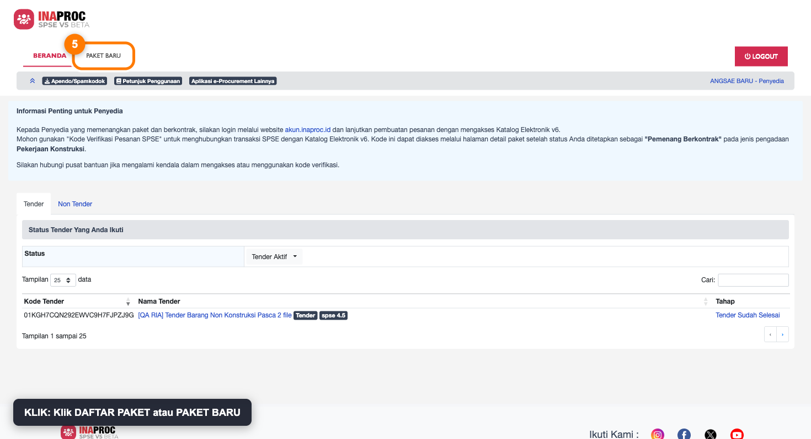

#### Langkah 6 — Pilih tab Non Tender

**Klik:** Tabel paket Non Tender ditampilkan.

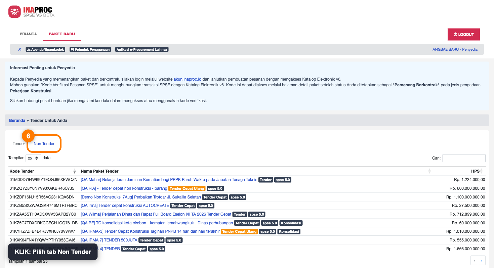

#### Langkah 7 — Buka paket [QA] [Penunjukan Langsung] [Automation] [070] - 65914625Belanja Obat-Obatan-Obat-Obatan Lainnya - Bahan Reagent (5.1.02.01.01.0038.06)BLUDPenunjukan LangsungRp 10,5 M2026Pengadaan BarangDINAS KESEHATAN - 1787328648283

**Klik:** Detail dan Pakta Integritas paket ditampilkan.

![Flow 4 langkah 7: Buka paket [QA] [Penunjukan Langsung] [Automation] [070] - 65914625Belanja Obat-Obatan-Obat-Obatan Lainnya - Bahan Reagent (5.1.02.01.01.0038.06)BLUDPenunjukan LangsungRp 10,5 M2026Pengadaan BarangDINAS KESEHATAN - 1787328648283](./flow4/07-buka-paket-qa-penunjukan-langsung-automation-070-65914625bel.png)

#### Langkah 8 — Klik Setuju & Ikut Paket

**Klik:** Penyedia menyetujui Pakta Integritas dan menerima paket.

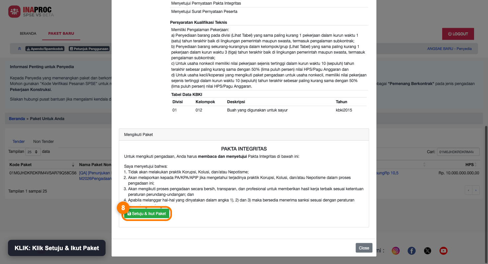

#### Langkah 9 — Kembali ke Beranda setelah menerima paket

**Klik:** Beranda Penyedia dan daftar Paket Untuk Anda ditampilkan.

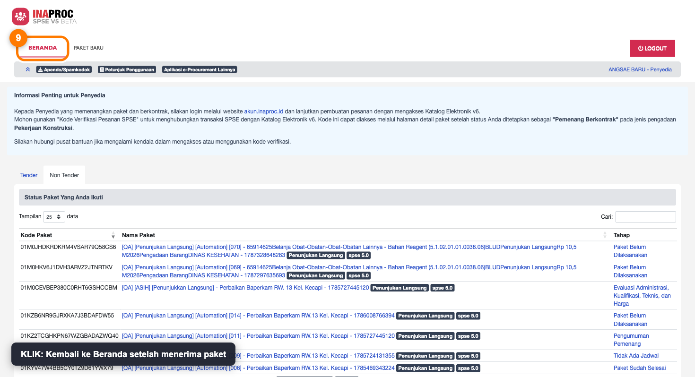

#### Langkah 10 — Pastikan paket yang disetujui muncul di Beranda

**Validasi:** Paket tercantum pada daftar Non Tender di Beranda Penyedia.


## Flow 5 — Tahap 1: Pemberian Penjelasan

**Peran:** Penyedia lalu Pokja  
**Tujuan:** Mengaktifkan sesi 25, mengirim lima pertanyaan (dua dengan lampiran), lalu Pokja menjawab semuanya dan mengunduh lampiran.

### Arahan singkat

- **Klik:** Klik LOGIN untuk masuk sebagai anggota Pokja. Halaman autentikasi ditampilkan.
- **Isi:** Isi Alamat email akun Penyedia. Email Penyedia siap diproses.
- **Isi:** Isi Sandi akun Penyedia. Sandi tersimpan secara tersensor.
- **Klik:** Klik Lanjutkan tanpa Security Key. Proses login Pokja berlanjut.
- **Pilih:** Pilih Sesi #25. Sesi #25 menjadi sesi pelatihan aktif.
- **Isi:** Ubah waktu Sesi #25 menjadi 23-08-2026 10:00 WIB. Waktu sesi berada dalam tahap Pemberian Penjelasan.
- **Klik:** Klik BERANDA untuk membuka paket yang telah diikuti. Beranda dan daftar paket yang diikuti Penyedia terbuka.
- **Klik:** Pilih tab Non Tender. Tabel paket Non Tender ditampilkan.
- **Klik:** Buka paket [QA] [Penunjukan Langsung] [Automation] [070] - 65914625Belanja Obat-Obatan-Obat-Obatan Lainnya - Bahan Reagent (5.1.02.01.01.0038.06)BLUDPenunjukan LangsungRp 10,5 M2026Pengadaan BarangDINAS KESEHATAN - 1787328648283. Detail paket yang telah diikuti Penyedia ditampilkan.
- **Klik:** Buka tab Pertanyaan dan Penjelasan. Forum Pemberian Penjelasan paket terbuka.
- **Klik:** Klik Kirim Pertanyaan untuk pertanyaan 1. Form pertanyaan terbuka.
- **Klik:** Kirim pertanyaan 1. Pertanyaan 1 tersimpan pada forum.
- **Klik:** Klik Kirim Pertanyaan untuk pertanyaan 2. Form pertanyaan terbuka.
- **Klik:** Kirim pertanyaan 2. Pertanyaan 2 tersimpan pada forum.
- **Klik:** Klik Kirim Pertanyaan untuk pertanyaan 3. Form pertanyaan terbuka.
- **Klik:** Kirim pertanyaan 3. Pertanyaan 3 tersimpan pada forum.
- **Klik:** Klik Kirim Pertanyaan untuk pertanyaan 4. Form pertanyaan terbuka.
- **Klik:** Kirim pertanyaan 4. Pertanyaan 4 tersimpan pada forum.
- **Klik:** Klik Kirim Pertanyaan untuk pertanyaan 5. Form pertanyaan terbuka.
- **Klik:** Kirim pertanyaan 5. Pertanyaan 5 tersimpan pada forum.
- **Download:** Penyedia mengunduh lampiran 1. File selesai diunduh dan tidak kosong.
- **Download:** Penyedia mengunduh lampiran 2. File selesai diunduh dan tidak kosong.
- **Isi:** Isi Alamat email anggota Pokja. Email siap diproses.
- **Isi:** Isi Sandi anggota Pokja. Sandi tersimpan secara tersensor.
- **Pilih:** Pilih role Anggota Pokja Pemilihan Kota Cirebon. Dashboard Pokja terbuka.
- **Klik:** Klik DAFTAR PAKET pada dashboard Pokja. Daftar paket Pokja ditampilkan.
- **Klik:** Klik tab Non Tender. Paket Penunjukan Langsung ditampilkan.
- **Klik:** Klik Buat Non Tender pada paket yang ditugaskan. Halaman konfigurasi paket terbuka.
- **Klik:** Klik Jawab untuk pertanyaan 1. Editor jawaban Pokja ditampilkan.
- **Klik:** Kirim penjelasan untuk pertanyaan 1. Penjelasan 1 tersimpan dan counter bertambah.
- **Klik:** Klik Jawab untuk pertanyaan 2. Editor jawaban Pokja ditampilkan.
- **Klik:** Kirim penjelasan untuk pertanyaan 2. Penjelasan 2 tersimpan dan counter bertambah.
- **Klik:** Klik Jawab untuk pertanyaan 3. Editor jawaban Pokja ditampilkan.
- **Klik:** Kirim penjelasan untuk pertanyaan 3. Penjelasan 3 tersimpan dan counter bertambah.
- **Klik:** Klik Jawab untuk pertanyaan 4. Editor jawaban Pokja ditampilkan.
- **Klik:** Kirim penjelasan untuk pertanyaan 4. Penjelasan 4 tersimpan dan counter bertambah.
- **Klik:** Klik Jawab untuk pertanyaan 5. Editor jawaban Pokja ditampilkan.
- **Klik:** Kirim penjelasan untuk pertanyaan 5. Penjelasan 5 tersimpan dan counter bertambah.
- **Download:** Pokja mengunduh lampiran 1. File selesai diunduh dan tidak kosong.
- **Download:** Pokja mengunduh lampiran 2. File selesai diunduh dan tidak kosong.

### Screenshot langkah

#### Langkah 1 — Klik LOGIN untuk masuk sebagai anggota Pokja

**Klik:** Halaman autentikasi ditampilkan.


#### Langkah 2 — Isi Alamat email akun Penyedia

**Isi:** Email Penyedia siap diproses.


#### Langkah 3 — Isi Sandi akun Penyedia

**Isi:** Sandi tersimpan secara tersensor.


#### Langkah 4 — Klik Lanjutkan tanpa Security Key

**Klik:** Proses login Pokja berlanjut.


#### Langkah 5 — Pilih Sesi #25

**Pilih:** Sesi #25 menjadi sesi pelatihan aktif.


#### Langkah 6 — Ubah waktu Sesi #25 menjadi 23-08-2026 10:00 WIB

**Isi:** Waktu sesi berada dalam tahap Pemberian Penjelasan.


#### Langkah 7 — Klik BERANDA untuk membuka paket yang telah diikuti

**Klik:** Beranda dan daftar paket yang diikuti Penyedia terbuka.


#### Langkah 8 — Pilih tab Non Tender

**Klik:** Tabel paket Non Tender ditampilkan.


#### Langkah 9 — Buka paket [QA] [Penunjukan Langsung] [Automation] [070] - 65914625Belanja Obat-Obatan-Obat-Obatan Lainnya - Bahan Reagent (5.1.02.01.01.0038.06)BLUDPenunjukan LangsungRp 10,5 M2026Pengadaan BarangDINAS KESEHATAN - 1787328648283

**Klik:** Detail paket yang telah diikuti Penyedia ditampilkan.

![Flow 5 langkah 9: Buka paket [QA] [Penunjukan Langsung] [Automation] [070] - 65914625Belanja Obat-Obatan-Obat-Obatan Lainnya - Bahan Reagent (5.1.02.01.01.0038.06)BLUDPenunjukan LangsungRp 10,5 M2026Pengadaan BarangDINAS KESEHATAN - 1787328648283](./flow5/09-buka-paket-qa-penunjukan-langsung-automation-070-65914625bel.png)

#### Langkah 10 — Buka tab Pertanyaan dan Penjelasan

**Klik:** Forum Pemberian Penjelasan paket terbuka.


#### Langkah 11 — Klik Kirim Pertanyaan untuk pertanyaan 1

**Klik:** Form pertanyaan terbuka.


#### Langkah 12 — Kirim pertanyaan 1

**Klik:** Pertanyaan 1 tersimpan pada forum.


#### Langkah 13 — Klik Kirim Pertanyaan untuk pertanyaan 2

**Klik:** Form pertanyaan terbuka.


#### Langkah 14 — Kirim pertanyaan 2

**Klik:** Pertanyaan 2 tersimpan pada forum.


#### Langkah 15 — Klik Kirim Pertanyaan untuk pertanyaan 3

**Klik:** Form pertanyaan terbuka.


#### Langkah 16 — Kirim pertanyaan 3

**Klik:** Pertanyaan 3 tersimpan pada forum.


#### Langkah 17 — Klik Kirim Pertanyaan untuk pertanyaan 4

**Klik:** Form pertanyaan terbuka.


#### Langkah 18 — Kirim pertanyaan 4

**Klik:** Pertanyaan 4 tersimpan pada forum.


#### Langkah 19 — Klik Kirim Pertanyaan untuk pertanyaan 5

**Klik:** Form pertanyaan terbuka.


#### Langkah 20 — Kirim pertanyaan 5

**Klik:** Pertanyaan 5 tersimpan pada forum.


#### Langkah 21 — Penyedia mengunduh lampiran 1

**Download:** File selesai diunduh dan tidak kosong.


#### Langkah 22 — Penyedia mengunduh lampiran 2

**Download:** File selesai diunduh dan tidak kosong.


#### Langkah 23 — Klik LOGIN untuk masuk sebagai anggota Pokja

**Klik:** Halaman autentikasi ditampilkan.


#### Langkah 24 — Isi Alamat email anggota Pokja

**Isi:** Email siap diproses.


#### Langkah 25 — Isi Sandi anggota Pokja

**Isi:** Sandi tersimpan secara tersensor.


#### Langkah 26 — Klik Lanjutkan tanpa Security Key

**Klik:** Proses login Pokja berlanjut.


#### Langkah 27 — Pilih role Anggota Pokja Pemilihan Kota Cirebon

**Pilih:** Dashboard Pokja terbuka.


#### Langkah 28 — Pilih Sesi #25

**Pilih:** Sesi #25 menjadi sesi pelatihan aktif.


#### Langkah 29 — Ubah waktu Sesi #25 menjadi 23-08-2026 10:00 WIB

**Isi:** Waktu sesi berada dalam tahap Pemberian Penjelasan.


#### Langkah 30 — Klik DAFTAR PAKET pada dashboard Pokja

**Klik:** Daftar paket Pokja ditampilkan.


#### Langkah 31 — Klik tab Non Tender

**Klik:** Paket Penunjukan Langsung ditampilkan.


#### Langkah 32 — Klik Buat Non Tender pada paket yang ditugaskan

**Klik:** Halaman konfigurasi paket terbuka.


#### Langkah 33 — Buka tab Pertanyaan dan Penjelasan

**Klik:** Forum Pemberian Penjelasan paket terbuka.


#### Langkah 34 — Klik Jawab untuk pertanyaan 1

**Klik:** Editor jawaban Pokja ditampilkan.


#### Langkah 35 — Kirim penjelasan untuk pertanyaan 1

**Klik:** Penjelasan 1 tersimpan dan counter bertambah.


#### Langkah 36 — Klik Jawab untuk pertanyaan 2

**Klik:** Editor jawaban Pokja ditampilkan.


#### Langkah 37 — Kirim penjelasan untuk pertanyaan 2

**Klik:** Penjelasan 2 tersimpan dan counter bertambah.


#### Langkah 38 — Klik Jawab untuk pertanyaan 3

**Klik:** Editor jawaban Pokja ditampilkan.


#### Langkah 39 — Kirim penjelasan untuk pertanyaan 3

**Klik:** Penjelasan 3 tersimpan dan counter bertambah.


#### Langkah 40 — Klik Jawab untuk pertanyaan 4

**Klik:** Editor jawaban Pokja ditampilkan.


#### Langkah 41 — Kirim penjelasan untuk pertanyaan 4

**Klik:** Penjelasan 4 tersimpan dan counter bertambah.


#### Langkah 42 — Klik Jawab untuk pertanyaan 5

**Klik:** Editor jawaban Pokja ditampilkan.


#### Langkah 43 — Kirim penjelasan untuk pertanyaan 5

**Klik:** Penjelasan 5 tersimpan dan counter bertambah.


#### Langkah 44 — Pokja mengunduh lampiran 1

**Download:** File selesai diunduh dan tidak kosong.


#### Langkah 45 — Pokja mengunduh lampiran 2

**Download:** File selesai diunduh dan tidak kosong.


## Flow 6 — Tahap 2: Upload Dokumen Penawaran

**Peran:** Penyedia / Angsae Baru  
**Tujuan:** Mengirim kualifikasi, Surat Penawaran, enam dokumen teknis, dua lampiran harga, harga + PPN 11%, dan TKDN/PDN.

### Arahan singkat

- **Klik:** Klik LOGIN untuk masuk sebagai anggota Pokja. Halaman autentikasi ditampilkan.
- **Isi:** Isi Alamat email akun Penyedia. Email Penyedia siap diproses.
- **Isi:** Isi Sandi akun Penyedia. Sandi tersimpan secara tersensor.
- **Klik:** Klik Lanjutkan tanpa Security Key. Proses login Pokja berlanjut.
- **Pilih:** Pilih Sesi #25. Sesi #25 menjadi sesi pelatihan aktif.
- **Isi:** Ubah waktu Sesi #25 menjadi 24-08-2026 10:00 WIB. Waktu sesi berada dalam tahap Pemberian Penjelasan.
- **Klik:** Klik BERANDA untuk membuka paket yang telah diikuti. Beranda dan daftar paket yang diikuti Penyedia terbuka.
- **Klik:** Pilih tab Non Tender. Tabel paket Non Tender ditampilkan.
- **Klik:** Buka paket [QA] [Penunjukan Langsung] [Automation] [070] - 65914625Belanja Obat-Obatan-Obat-Obatan Lainnya - Bahan Reagent (5.1.02.01.01.0038.06)BLUDPenunjukan LangsungRp 10,5 M2026Pengadaan BarangDINAS KESEHATAN - 1787328648283. Detail paket yang telah diikuti Penyedia ditampilkan.
- **Klik:** Klik Kirim Data/Ubah Data pada Dokumen Kualifikasi. Wizard Data Kualifikasi terbuka.
- **Klik:** Klik Kirim Data Kualifikasi. Konfirmasi pengiriman Data Kualifikasi ditampilkan.
- **Klik:** Klik Kirim Penawaran. Tahap Surat Penawaran ditampilkan.
- **Isi:** Isi masa berlaku penawaran 90 hari. Masa berlaku Surat Penawaran terisi.
- **Klik:** Klik Setuju pada Surat Penawaran. Surat Penawaran disetujui dan tahap teknis dibuka.
- **Isi:** Isi nilai TKDN/PDN 20%. Total PDN dihitung dari total penawaran.
- **Klik:** Klik Simpan pada Penawaran Harga. Rincian harga, PPN, dan TKDN tersimpan.

### Screenshot langkah

#### Langkah 1 — Klik LOGIN untuk masuk sebagai anggota Pokja

**Klik:** Halaman autentikasi ditampilkan.


#### Langkah 2 — Isi Alamat email akun Penyedia

**Isi:** Email Penyedia siap diproses.


#### Langkah 3 — Isi Sandi akun Penyedia

**Isi:** Sandi tersimpan secara tersensor.


#### Langkah 4 — Klik Lanjutkan tanpa Security Key

**Klik:** Proses login Pokja berlanjut.


#### Langkah 5 — Pilih Sesi #25

**Pilih:** Sesi #25 menjadi sesi pelatihan aktif.


#### Langkah 6 — Ubah waktu Sesi #25 menjadi 24-08-2026 10:00 WIB

**Isi:** Waktu sesi berada dalam tahap Pemberian Penjelasan.


#### Langkah 7 — Klik BERANDA untuk membuka paket yang telah diikuti

**Klik:** Beranda dan daftar paket yang diikuti Penyedia terbuka.


#### Langkah 8 — Pilih tab Non Tender

**Klik:** Tabel paket Non Tender ditampilkan.


#### Langkah 9 — Buka paket [QA] [Penunjukan Langsung] [Automation] [070] - 65914625Belanja Obat-Obatan-Obat-Obatan Lainnya - Bahan Reagent (5.1.02.01.01.0038.06)BLUDPenunjukan LangsungRp 10,5 M2026Pengadaan BarangDINAS KESEHATAN - 1787328648283

**Klik:** Detail paket yang telah diikuti Penyedia ditampilkan.

![Flow 6 langkah 9: Buka paket [QA] [Penunjukan Langsung] [Automation] [070] - 65914625Belanja Obat-Obatan-Obat-Obatan Lainnya - Bahan Reagent (5.1.02.01.01.0038.06)BLUDPenunjukan LangsungRp 10,5 M2026Pengadaan BarangDINAS KESEHATAN - 1787328648283](./flow6/09-buka-paket-qa-penunjukan-langsung-automation-070-65914625bel.png)

#### Langkah 10 — Klik Kirim Data/Ubah Data pada Dokumen Kualifikasi

**Klik:** Wizard Data Kualifikasi terbuka.


#### Langkah 11 — Klik Kirim Data Kualifikasi

**Klik:** Konfirmasi pengiriman Data Kualifikasi ditampilkan.


#### Langkah 1 — Klik LOGIN untuk masuk sebagai anggota Pokja

**Klik:** Halaman autentikasi ditampilkan.


#### Langkah 2 — Isi Alamat email akun Penyedia

**Isi:** Email Penyedia siap diproses.


#### Langkah 3 — Isi Sandi akun Penyedia

**Isi:** Sandi tersimpan secara tersensor.


#### Langkah 4 — Klik Lanjutkan tanpa Security Key

**Klik:** Proses login Pokja berlanjut.


#### Langkah 5 — Pilih Sesi #25

**Pilih:** Sesi #25 menjadi sesi pelatihan aktif.


#### Langkah 6 — Ubah waktu Sesi #25 menjadi 24-08-2026 10:00 WIB

**Isi:** Waktu sesi berada dalam tahap Pemberian Penjelasan.


#### Langkah 7 — Klik BERANDA untuk membuka paket yang telah diikuti

**Klik:** Beranda dan daftar paket yang diikuti Penyedia terbuka.


#### Langkah 8 — Pilih tab Non Tender

**Klik:** Tabel paket Non Tender ditampilkan.


#### Langkah 9 — Buka paket [QA] [Penunjukan Langsung] [Automation] [070] - 65914625Belanja Obat-Obatan-Obat-Obatan Lainnya - Bahan Reagent (5.1.02.01.01.0038.06)BLUDPenunjukan LangsungRp 10,5 M2026Pengadaan BarangDINAS KESEHATAN - 1787328648283

**Klik:** Detail paket yang telah diikuti Penyedia ditampilkan.

![Flow 6 langkah 9: Buka paket [QA] [Penunjukan Langsung] [Automation] [070] - 65914625Belanja Obat-Obatan-Obat-Obatan Lainnya - Bahan Reagent (5.1.02.01.01.0038.06)BLUDPenunjukan LangsungRp 10,5 M2026Pengadaan BarangDINAS KESEHATAN - 1787328648283](./flow6/09-buka-paket-qa-penunjukan-langsung-automation-070-65914625bel.png)

#### Langkah 10 — Klik Kirim Penawaran

**Klik:** Tahap Surat Penawaran ditampilkan.


#### Langkah 11 — Isi masa berlaku penawaran 90 hari

**Isi:** Masa berlaku Surat Penawaran terisi.


#### Langkah 12 — Klik Setuju pada Surat Penawaran

**Klik:** Surat Penawaran disetujui dan tahap teknis dibuka.


#### Langkah 13 — Isi Alamat email akun Penyedia

**Isi:** Email Penyedia siap diproses.


#### Langkah 14 — Isi Sandi akun Penyedia

**Isi:** Sandi tersimpan secara tersensor.


#### Langkah 15 — Klik Lanjutkan tanpa Security Key

**Klik:** Proses login Pokja berlanjut.


#### Langkah 16 — Pilih Sesi #25

**Pilih:** Sesi #25 menjadi sesi pelatihan aktif.


#### Langkah 17 — Ubah waktu Sesi #25 menjadi 24-08-2026 10:00 WIB

**Isi:** Waktu sesi berada dalam tahap Pemberian Penjelasan.


#### Langkah 18 — Klik LOGIN untuk masuk sebagai anggota Pokja

**Klik:** Halaman autentikasi ditampilkan.


#### Langkah 19 — Isi Alamat email akun Penyedia

**Isi:** Email Penyedia siap diproses.


#### Langkah 20 — Isi Sandi akun Penyedia

**Isi:** Sandi tersimpan secara tersensor.


#### Langkah 21 — Klik Lanjutkan tanpa Security Key

**Klik:** Proses login Pokja berlanjut.


#### Langkah 22 — Pilih Sesi #25

**Pilih:** Sesi #25 menjadi sesi pelatihan aktif.


#### Langkah 23 — Ubah waktu Sesi #25 menjadi 24-08-2026 10:00 WIB

**Isi:** Waktu sesi berada dalam tahap Pemberian Penjelasan.


#### Langkah 24 — Isi nilai TKDN/PDN 20%

**Isi:** Total PDN dihitung dari total penawaran.


#### Langkah 25 — Klik Simpan pada Penawaran Harga

**Klik:** Rincian harga, PPN, dan TKDN tersimpan.


#### Langkah 26 — Klik LOGIN untuk masuk sebagai anggota Pokja

**Klik:** Halaman autentikasi ditampilkan.


#### Langkah 27 — Isi Alamat email akun Penyedia

**Isi:** Email Penyedia siap diproses.


#### Langkah 28 — Isi Sandi akun Penyedia

**Isi:** Sandi tersimpan secara tersensor.


#### Langkah 29 — Klik Lanjutkan tanpa Security Key

**Klik:** Proses login Pokja berlanjut.


#### Langkah 30 — Pilih Sesi #25

**Pilih:** Sesi #25 menjadi sesi pelatihan aktif.


#### Langkah 31 — Ubah waktu Sesi #25 menjadi 24-08-2026 10:00 WIB

**Isi:** Waktu sesi berada dalam tahap Pemberian Penjelasan.


## Catatan hasil aktual

- Flow 3 sempat menemukan katalog KBKI kosong pada respons pertama. Implementasi sekarang melakukan retry pencarian huruf `b`, menunggu data async, membuka ulang dropdown, dan mengulang konteks Pokja; eksekusi ini berhasil menyelesaikan ketiga persetujuan.
- Pada Flow 6, nilai sebelum PPN Rp9.000.000.000, PPN 11% Rp990.000.000, total Rp9.990.000.000 (di bawah HPS Rp10.000.000.000).
- Dua lampiran pertanyaan Flow 5, enam upload teknis Flow 6, dan dua lampiran harga tervalidasi dengan nama file, ukuran, hash SHA-256, dan/atau download.
- UI staging saat ini tidak mengekspos link TTE/Bukti Penyampaian Penawaran; validasi akhir mencatat status tersebut sebagai `NOT_EXPOSED_BY_CURRENT_UI`.
- Server menerima payload Total PDN, tetapi setelah reload input persentase PDN kembali `0`; ini dicatat di manifest sebagai `tkdnPersisted: false` dan bukan kegagalan pengiriman harga.
